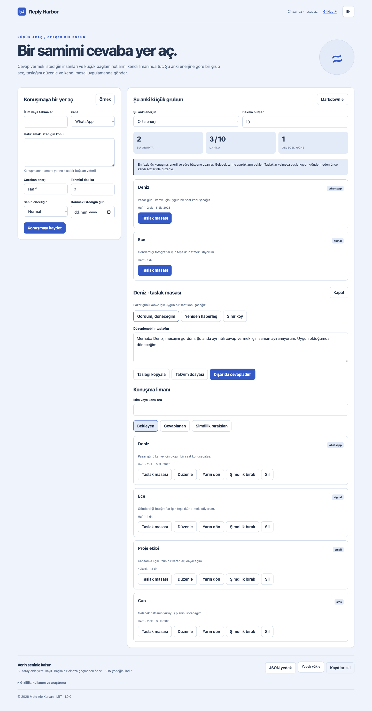

# Reply Harbor

Cevap vermek istediğin konuşmalar için özel bir masa. Enerjine uygun küçük bir grup seç, kendi sözlerinle bir taslak yaz ve kendi mesaj uygulamanda gönder.

[Canlı uygulama](https://metealpkarvan.github.io/reply-harbor/) · [İndir](https://github.com/metealpkarvan/reply-harbor/releases/latest) · [English](README.md)

## Özellikler

- İsim veya takma ad, kanal, kısa bağlam, senin önceliğin, enerji/süre tahmini ve takip günü.
- Süre ve enerji bütçene uyan en fazla üç konuşma; ileri tarihe ayırdıkların bekler.
- Üç özgün ve düzenlenebilir başlangıç taslağı: gördüm/döneceğim, yeniden haberleşme ve sınır koyma.
- Saklanan taslaklar, Türkçe arama, bırakılan/cevaplanan durumları, Markdown, JSON ve takvim dosyası.

## Başla

1. **Örnek** ile kurgusal dört konuşma niyetini aç.
2. Kısa bir bağlam ve gereken emeği gir; özel konuşmanın tamamını kopyalamana gerek yok.
3. Şu anki enerjini ve zamanını seç. Taslak masasını açıp başlangıç cümlelerini düzenle.
4. Taslağı kopyala, kendi uygulamanda gönder ve ardından cevapladığını işaretle. İstersen takip gününü takvimine aktar.

İndirilen ZIP'i çıkarıp **index.html** dosyasını güncel tarayıcında açabilirsin. Paket hazırlanmış JavaScript içerir; Node.js, sunucu veya API anahtarı gerekmez. Canlı uygulama daha öngörülebilir tarayıcı kaydı sağlar. İndirilen klasörü taşımadan veya canlı uygulamaya geçmeden önce JSON yedeğini indir; `file:` sayfalarının yerel kayıt davranışı tarayıcıya ve konuma göre değişebilir.

## Veriler ve sınırlar

En fazla 100 elle girilen konuşma. Enerji kişisel bir tahmindir. Seçim puanı öncelik × 100 ve günü gelmiş takipler için +30’dur. Taslaklar duygu tahmin etmez ve kişisel mazeret uydurmaz. Uygulama hesap okumaz, mesaj göndermez, gönderim zamanlamaz, eşitlemez veya arka planda bildirim üretmez. Takvim dosyası alarmsız tüm gün etkinliğidir; hatırlatma ayarı takvimine bağlıdır. Enerji ve zaman bütçesi yeniden açılışta varsayılana döner.

Kayıtların bu tarayıcıda saklanır ve şifreli değildir. Hesap, bulut eşitleme, analitik veya AI API çağrısı yoktur. Tarayıcı verilerini silmek kayıtları da silebilir. Bozuk kayıt üzerine yazma engellenir; orijinal kaydı indirme seçeneği vardır. Yedek yüklemeden önce içerik doğrulanır ve onaydan sonra mevcut verilerin kurtarma kopyası indirilir. JSON içe aktarımı 3 MB ile sınırlıdır.

Canlı uygulama ilk çevrimiçi açılıştan sonra arayüzünü çevrimdışı açabilir. Bağlantı verdiğin siteler önbelleğe alınmaz. Türkçe/İngilizce geçişi düğmeleri çevirir; senin yazdığın içerikleri değiştirmez.

## Araştırma ve doğrulama

5 Ekim 2026'da erişilen üç X gönderisi ve sekiz Reddit tartışmasından türetilen tasarım varsayımları [araştırma kaydında](docs/COMMUNITY-RESEARCH-2026-10-05.md) açıklanır. Eksik X metinleri, tarih belirsizliği ve ürün tanıtımı içeren kaynaklar açıkça işaretlidir. Kullanıcı testiyle ölçülmüş fayda veya toplumun tamamına dair genelleme yoktur.

**38 otomatik kural/paket kontrolü**, gerçek tarayıcı kullanım akışları, mobil görünüm ve çevrimdışı açılış kontrol edildi. CI, Intel ve Apple Silicon üzerinde yerel Node.js ile çalışır. Uygulama her iki Mac türünde modern tarayıcıyla açılır; Rosetta gerekmez. Geliştirme için Node.js 22+, isteğe bağlı yerel sunucu için Python 3 kullanılır.

MIT · Mete Alp Karvan
